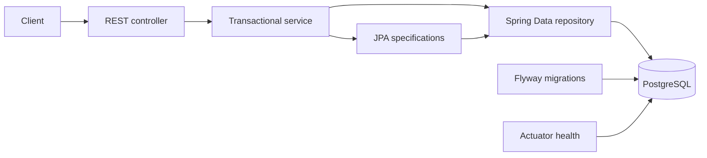

# Product catalog backend

A stateless REST service for creating, retrieving, listing, filtering, updating and deleting products. It targets a catalog of a few hundred thousand rows where reads substantially outnumber writes. PostgreSQL is the source of truth, all filtering and pagination happen in the database, and USD is the only accepted currency so price comparisons are meaningful.

Authentication and authorization are outside this assessment's scope. A production deployment must add them at the platform or application boundary.

## Architecture



This is a layered monolith: [`ProductController`](src/main/java/com/example/productcatalog/controller/ProductController.java) owns HTTP concerns, [`ProductService`](src/main/java/com/example/productcatalog/service/ProductService.java) owns transactions and mapping, [`ProductRepository`](src/main/java/com/example/productcatalog/repository/ProductRepository.java) owns persistence access, and [`ProductSpecifications`](src/main/java/com/example/productcatalog/specification/ProductSpecifications.java) builds dynamic filters. DTOs keep the API contract separate from [`Product`](src/main/java/com/example/productcatalog/entity/Product.java). [`GlobalExceptionHandler`](src/main/java/com/example/productcatalog/exception/GlobalExceptionHandler.java) provides one error shape.

At this scale, splitting CRUD and query behavior into microservices would add network failure modes, distributed consistency and operational cost without an independent scaling or ownership requirement. PostgreSQL can comfortably index and query hundreds of thousands of rows on ordinary hardware. Redis, Elasticsearch, sharding and Kubernetes are deliberately absent because the stated requirements do not justify them.

## Technology choices

- Java 17 and Spring Boot 3.5.16: supported combination, constructor injection, validation, MVC, JPA and operational health support.
- PostgreSQL 17.7: transactions, constraints, exact numeric values, mature indexing and sufficient capacity for the stated catalog.
- Flyway: immutable, reviewable schema changes. Hibernate uses `validate`; it never creates the production schema.
- `BigDecimal` mapped to `NUMERIC(19,2)`: exact USD amounts rather than floating-point values.
- JPA Specifications: composable optional category/minimum/maximum predicates without loading collections into memory.
- Testcontainers PostgreSQL: tests the real SQL dialect, constraints and optimistic-lock behavior; H2 is not used.

## Data model and indexes

The schema is created by [`V1__create_products.sql`](src/main/resources/db/migration/V1__create_products.sql), while [`V2__remove_redundant_category_id_index.sql`](src/main/resources/db/migration/V2__remove_redundant_category_id_index.sql) records the measured removal of an initially proposed index without rewriting applied migration history. Database constraints enforce non-null fields, unique SKU, non-negative price and `USD` currency independently of API validation. `TIMESTAMPTZ` stores UTC instants and `version` supports optimistic locking.

The primary key supports ID lookup and default `id` pagination. The SKU unique constraint supplies its lookup index. `(price, id)` supports price ranges ordered by price with a unique tie-breaker. `(category, price, id)` uses equality on the leading category column, then a price range, then deterministic `id`; its leftmost prefix also supports category-only filtering. A tested `(category, id)` index was removed because PostgreSQL did not select it for the representative shallow or deep category queries. Actual plans and measurements are in [`docs/performance.md`](docs/performance.md).

Indexes improve reads at the cost of storage and write amplification. The final set follows measured query patterns rather than indexing every sortable field. Sorting by `name`, `sku`, `createdAt` or `updatedAt` remains database-side but may require a sort; add an index only when production query statistics demonstrate the need.

## API contract

- `POST /api/v1/products` returns `201 Created` with a `Location` header.
- `GET /api/v1/products/{id}` returns `200 OK` or `404 Not Found`.
- `GET /api/v1/products` returns `200 OK` with content and pagination metadata.
- `PUT /api/v1/products/{id}` returns `200 OK`, `404 Not Found`, or `409 Conflict` for a stale version.
- `DELETE /api/v1/products/{id}` returns `204 No Content` or `404 Not Found`.

Create a product:

```bash
curl -i -X POST http://localhost:8080/api/v1/products \
  -H 'Content-Type: application/json' \
  -d '{"sku":"LAMP-001","name":"Desk lamp","description":"LED task lamp","category":"Lighting","price":29.99,"currency":"USD"}'
```

Read, filter and paginate:

```bash
curl http://localhost:8080/api/v1/products/1
curl 'http://localhost:8080/api/v1/products?category=Lighting&minPrice=20&maxPrice=80&page=0&size=20&sort=price&direction=asc'
```

Update using the version returned by the latest read:

```bash
curl -i -X PUT http://localhost:8080/api/v1/products/1 \
  -H 'Content-Type: application/json' \
  -d '{"sku":"LAMP-001","name":"Desk lamp v2","description":"Updated","category":"Lighting","price":34.99,"currency":"USD","version":0}'
```

Delete:

```bash
curl -i -X DELETE http://localhost:8080/api/v1/products/1
```

Validation failures return `400`; missing products return `404`; duplicate SKU and stale writes return `409`. Errors contain `timestamp`, `status`, `error`, `message`, `path` and `validationErrors`.

### Filtering, sorting and pagination

`category`, `minPrice` and `maxPrice` are optional and composable. Prices must be non-negative and `minPrice` cannot exceed `maxPrice`. Pages are zero-based; size defaults to 20 and must be 1 through 100. Sort fields are `id`, `sku`, `name`, `category`, `price`, `createdAt` and `updatedAt`; direction is `asc` or `desc`.

Default ordering is `id asc`. For every other sort, the same direction on unique `id` is appended as a deterministic tie-breaker. The response includes `content`, `page`, `size`, `totalElements`, `totalPages`, `first` and `last`.

Offset pagination is simple and supports direct page access, but the database must scan or sort through skipped rows and concurrent inserts can shift page boundaries. The measured deep-page penalty is documented in [`docs/performance.md`](docs/performance.md). Cursor pagination becomes appropriate when clients routinely traverse deep result sets; the cursor must contain the active sort value and `id`.

## Concurrency

[`Product`](src/main/java/com/example/productcatalog/entity/Product.java) uses JPA `@Version`. A PUT must send the version observed by the client. The service explicitly rejects an already-stale version even when the earlier update committed in a different transaction; Hibernate also detects a race that occurs after the explicit check. Both cases return `409 Conflict`. Reads use read-only transactions; writes use ordinary transactions and flush before returning so constraint and locking errors are mapped within the request.

## Run locally

Prerequisites are Docker Desktop with Compose. The local Compose credentials are intentionally non-production values and live only in [`compose.yaml`](compose.yaml).

```bash
docker compose up --build
```

The application is at `http://localhost:8080`; health is at `http://localhost:8080/actuator/health`. PostgreSQL data persists in the named `product-catalog-postgres` volume. Stop services with `docker compose down`; add `--volumes` only when intentionally deleting local data.

Without containerizing the application, use the pinned Maven Wrapper and Java 17:

```bash
export JAVA_HOME=/usr/local/opt/openjdk@17/libexec/openjdk.jdk/Contents/Home
export PATH="$JAVA_HOME/bin:$PATH"
./mvnw spring-boot:run
```

Database connection settings are environment variables: `DB_URL`, `DB_USERNAME`, `DB_PASSWORD`, `DB_POOL_SIZE` and `DB_POOL_MIN_IDLE`.

## Tests and verification

Run all tests and package verification:

```bash
export JAVA_HOME=/usr/local/opt/openjdk@17/libexec/openjdk.jdk/Contents/Home
export PATH="$JAVA_HOME/bin:$PATH"
./mvnw clean verify
```

[`ProductApiIntegrationTest`](src/test/java/com/example/productcatalog/ProductApiIntegrationTest.java) starts PostgreSQL 17.7 through Testcontainers and covers create/read/update/delete, duplicate SKU, missing products, invalid payloads, category/price/combined filters, page ordering, invalid filters, stale updates and direct JDBC attempts that violate SKU, price and currency constraints.

Local verification on 2026-11-25 completed 11 tests with zero failures. The multi-stage image built and exported successfully, both Compose services became healthy, and live HTTP CRUD/filter/pagination assertions passed. The performance fixture, plans and repeatable benchmark evidence are in [`docs/performance.md`](docs/performance.md).

## CI

[`ci.yml`](.github/workflows/ci.yml) runs on pushes and pull requests. It checks out the repository, installs Temurin Java 17, caches Maven dependencies, runs `./mvnw --batch-mode clean verify` (including PostgreSQL Testcontainers), and only after successful tests builds the Docker image. A failed test stops the job before image verification. No arbitrary coverage threshold is imposed.

## Read-heavy scaling decisions

PostgreSQL is sufficient while the working set, write rate and indexed queries fit one primary instance. Before adding infrastructure, inspect slow-query logs, `pg_stat_statements`, cache hit rates, pool saturation and actual plans.

Caching is useful only when repeated hot reads materially load the database. Cache product-by-ID/SKU responses with a bounded TTL and invalidate or replace those keys after a successful create/update/delete commit. Filtered pages are harder to invalidate because one write can affect many keys; short TTLs or versioned namespaces are safer than attempting exhaustive invalidation.

Read replicas become appropriate when optimized reads saturate the primary. They reduce primary read load but are asynchronously replicated: a client may not immediately read its own write, and pagination/count results may lag. Route consistency-sensitive reads to the primary and accept/document lag for replica traffic.

No sharding is warranted for a few hundred thousand products. Consider it only after vertical scaling, query/index tuning, caching and replicas are demonstrably insufficient; sharding adds routing, rebalancing and cross-shard query complexity.

## Assessment traceability and known limitations

- Layered implementation: the `controller`, `service`, `repository`, `entity`, `dto`, `specification` and `exception` packages under `src/main/java`.
- Persistence and optimization: Flyway migration plus measured plans in `docs/performance.md`.
- API correctness and datastore behavior: PostgreSQL Testcontainers suite plus live Compose HTTP verification.
- Reproducible delivery: pinned Maven distribution in [`.mvn/wrapper/maven-wrapper.properties`](.mvn/wrapper/maven-wrapper.properties), multi-stage non-root [`Dockerfile`](Dockerfile), health-ordered [`compose.yaml`](compose.yaml), and GitHub Actions CI.
- Operational behavior: external configuration, graceful shutdown, connection-pool bounds, useful default logging and Actuator liveness/readiness health.
- Performance evidence: deterministic 300,000-row generator, representative execution plans, database workload and HTTP workload in `scripts/` and `docs/performance.md`.

Known limitations are the absence of authentication/authorization, one supported currency, offset rather than cursor pagination, no product images/inventory/full-text search, no conditional delete version, and no production deployment configuration. These are deliberate scope boundaries, not undocumented features.
